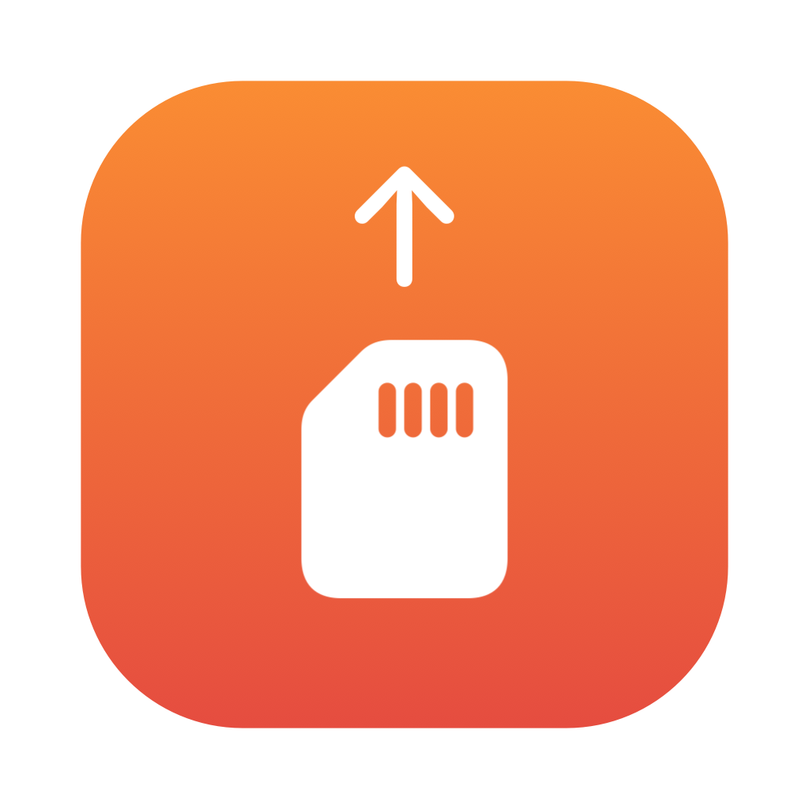

<p align="center"></p>

<h1 align="center">CardHaul</h1>

<p align="center"><b>Plug in your camera. Footage goes to Google Drive. You're told when it's safe to wipe the card.</b></p>

<p align="center">A free menu bar / system tray app for <b>macOS</b> and <b>Windows</b>.</p>

---

When you plug in a camera, drone or SD card you've added, CardHaul uploads the new files straight to a
**CardHaul** folder in your Google Drive, checks every file against the uploaded copy, and notifies you
when it's safe to clear the device.

## Why CardHaul?

Google Drive for desktop only offers **two-way sync**: when you clear your camera, it deletes the same
files from the cloud. CardHaul is deliberately **one-way**.

| | Drive for desktop sync | CardHaul |
|---|---|---|
| Clearing the card deletes the cloud copy | Yes | **Never** |
| Needs free space on your computer | Yes (it caches uploads) | **No**, it streams from the card |
| Tells you when it's safe to wipe the card | No | **Yes, after checking every file** |
| Can see the rest of your Drive | Yes | **No**, only the files it uploaded |

## Features

- **One-way and additive.** Files are only ever added to Drive. Nothing is deleted or overwritten.
- **Verified.** Every file is checked against Google's copy by checksum (safest; about 1 hour per 100 GB) or by size (seconds).
- **Live progress** in the menu bar / tray: percentage, files, speed and time left.
- **Pause, cancel, eject** from the tray. A cancelled device is skipped until you unplug it.
- **No local copies.** Files stream from the device, so a 500 GB card works on a computer with 20 GB free.
- **Private.** Uses Google's narrowest Drive permission (`drive.file`): CardHaul can only see files it created.
  No servers, no tracking. See the [privacy policy](https://cknm-cmd.github.io/cardhaul/privacy.html).
- **Notifications** when uploads start, finish, need attention, or a device is unplugged too early.
- **Upload history**, start at login, and multiple devices, each with its own Drive folder.

## Download

Get the latest version from **[Releases](https://github.com/cknm-cmd/cardhaul/releases/latest)**:

| File | For |
|---|---|
| `CardHaul-x.y.z-mac.dmg` | macOS 12 or later (Apple Silicon). Open it and drag CardHaul to Applications. |
| `CardHaul-x.y.z-mac.zip` | Same app, zipped |
| `CardHaul-x.y.z-windows-setup.exe` | Windows 10/11 installer. No admin rights needed. Adds a Start menu entry and an uninstaller. |
| `CardHaul-x.y.z-windows-portable.exe` | Windows, single file, runs from anywhere with nothing installed |

The installer and portable versions share the same settings, so you can try the portable one and install
later without signing in again.

### First launch: security warnings

CardHaul isn't signed with a paid Apple or Microsoft certificate yet, so your system will warn you once:

- **macOS:** if you see "CardHaul can't be opened", open **System Settings → Privacy & Security**, scroll down,
  and click **Open Anyway** next to the CardHaul message.
- **Windows:** on "Windows protected your PC", click **More info → Run anyway**.

## Getting started

1. Open CardHaul. It lives in the **menu bar** (macOS) or **system tray** (Windows), and Settings opens on first launch.
2. Click **Sign in with Google** and allow access.
3. Plug in your camera or card, click **+ Add device**, and pick it from the list (usually with the `DCIM` folder).
4. That's it. From now on, plugging it in starts an upload. Wait for **"✅ upload verified. Safe to clear the device"**.

macOS asks once for permission to read removable volumes and to send notifications. Click **Allow** for both.

## Command-line alternative

Prefer a terminal and scripts? **[cardrop](https://github.com/cknm-cmd/cardrop)** is the original
command-line version for macOS (it uses your own rclone setup and can upload to any rclone remote).

## Building from source

Requirements: Go 1.25+, Node 20+, and the [Wails 3](https://v3.wails.io) CLI
(`go install github.com/wailsapp/wails/v3/cmd/wails3@latest`).

```bash
git clone https://github.com/cknm-cmd/cardhaul.git
cd cardhaul
wails3 dev                 # run with live reload
wails3 task darwin:package # build bin/CardHaul.app
```

**Google sign-in for your build:** create a Google Cloud project with the Drive API enabled and a
**Desktop app** OAuth client (the `drive.file` scope is enough), then either:

- put the downloaded client JSON at `~/Library/Application Support/CardHaul/google-client.json`
  (`%AppData%\CardHaul\google-client.json` on Windows) for development, or
- create `.env.local` (git-ignored) with `CARDHAUL_GOOGLE_CLIENT_ID=...` and `CARDHAUL_GOOGLE_CLIENT_SECRET=...`
  to build the client into release builds.

`scripts/release.sh` builds every download (macOS dmg/zip, Windows installer/portable) into `dist/`.
The Windows installer needs `makensis` (`brew install makensis`).

### How it works

- Written in Go with [Wails 3](https://v3.wails.io) (tray icon, windows, notifications) and Svelte for the interface.
- Uploads and verification use [rclone](https://rclone.org) as a built-in library: `copy` with
  `--ignore-existing` (never overwrites) and `check --one-way`.
- Devices are detected by polling mounted volumes every 2 seconds (`/Volumes` on macOS, drive letters on Windows).
- Settings and history: `~/Library/Application Support/CardHaul` or `%AppData%\CardHaul`.
  The Google token is kept in the macOS Keychain or Windows Credential Manager.

## License

[MIT](LICENSE). CardHaul is not affiliated with Google, Insta360, GoPro or DJI. Google Drive is a trademark of Google LLC.
